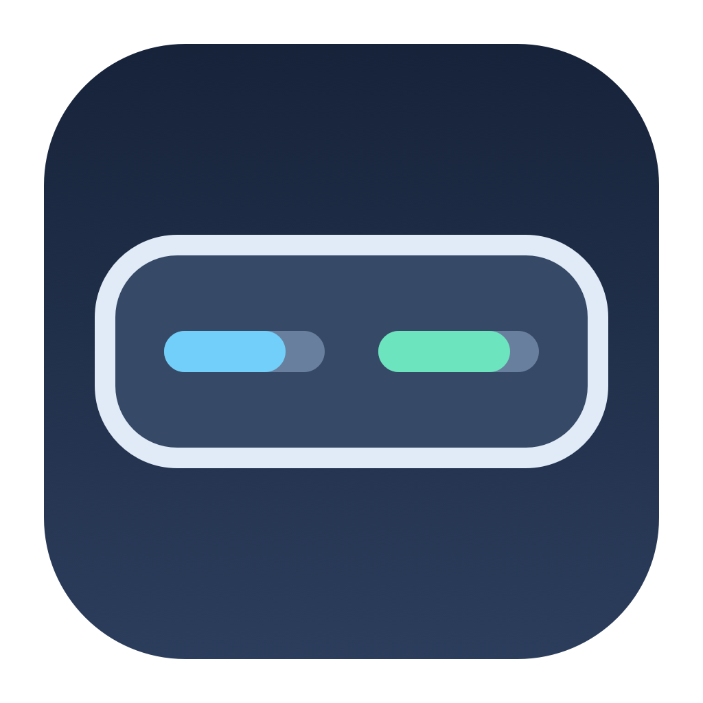
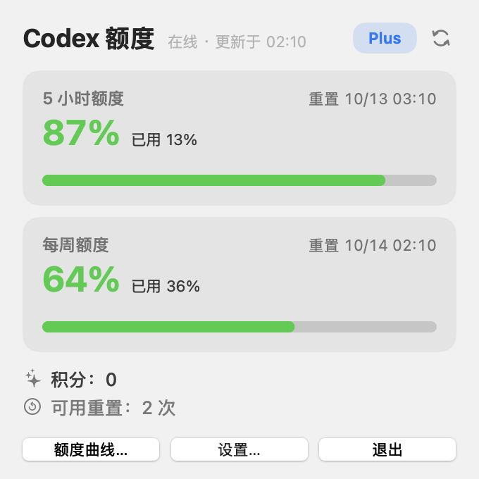
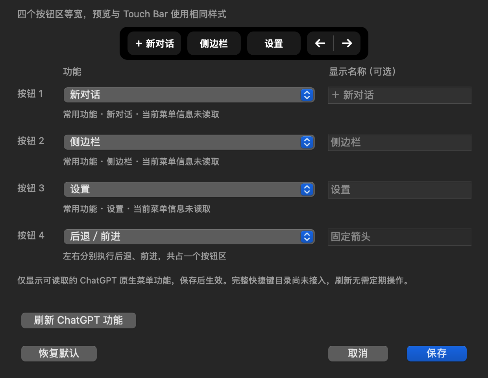
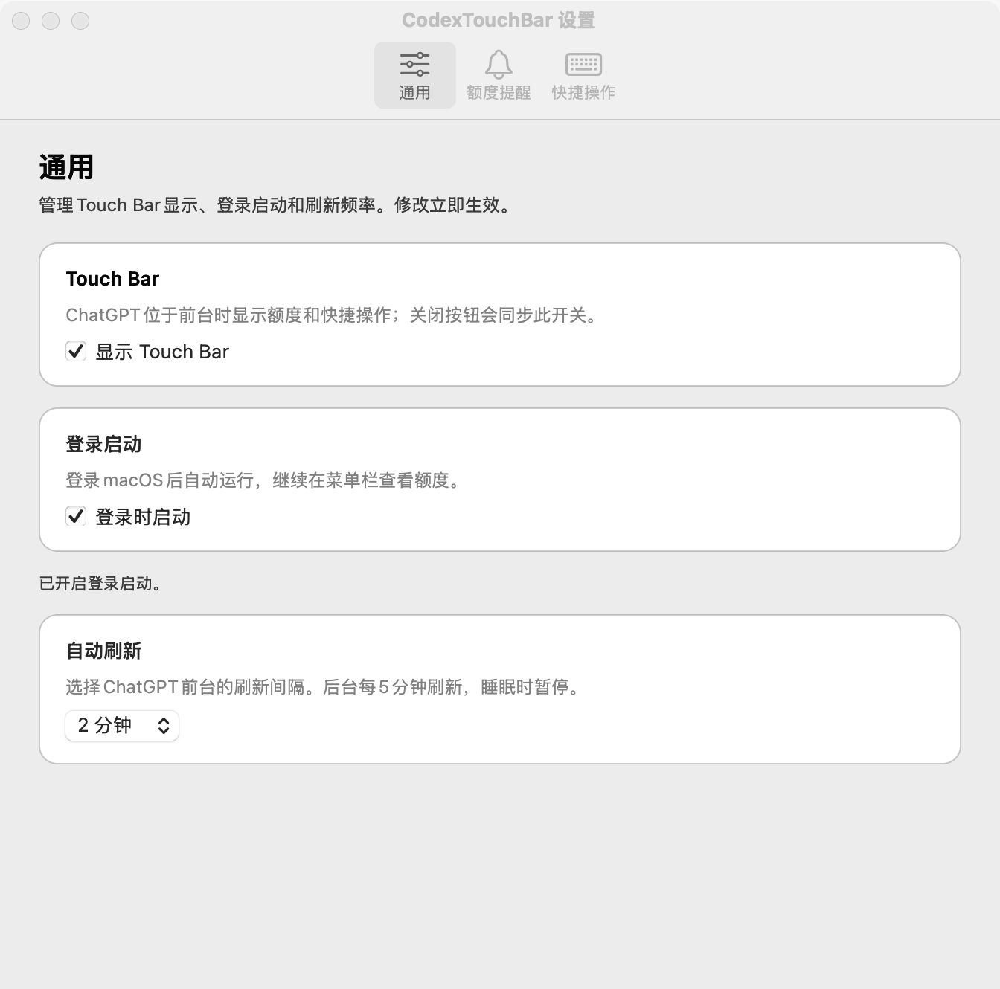
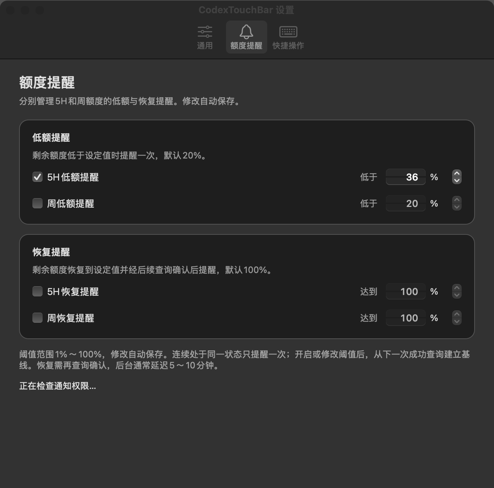
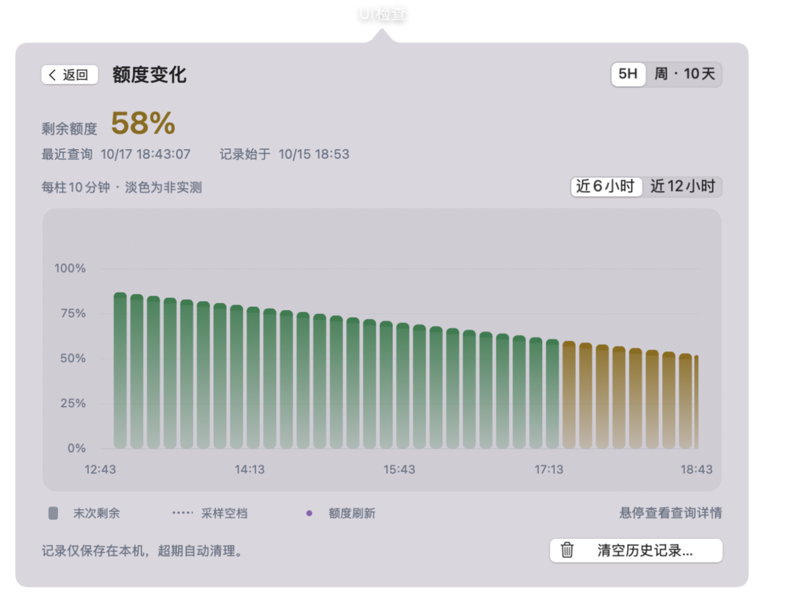

<div align="center">
  
  <h1>Codex TouchBar</h1>
  <p><strong>抬眼看额度，伸手做操作。</strong></p>
  <p>在 macOS 菜单栏和 Touch Bar 查看 Codex 剩余额度，设置提醒，回看变化。</p>
  <p>
    <a href="https://github.com/NUMS-half/Codex-TouchBar/releases"></a>
    
    
    <a href="https://github.com/NUMS-half/Codex-TouchBar/stargazers"></a>
  </p>
  <p>
    <a href="#快速开始">快速开始</a> ·
    <a href="#功能与界面">功能与界面</a> ·
    <a href="#常见问题">常见问题</a> ·
    <a href="CHANGELOG.md">更新记录</a> ·
    <a href="https://github.com/NUMS-half/Codex-TouchBar/issues">反馈问题</a>
  </p>
</div>

<p align="center">
  
</p>
<p align="center"><sub>原生界面预览。本文截图中的额度、曲线和设置均为示例。</sub></p>

## 你可以用它做什么

| 功能 | 日常用途 |
| :--- | :--- |
| **随时看额度** | 菜单栏同时显示5H、周剩余百分比，点击查看重置时间和额度详情。 |
| **Touch Bar 快捷操作** | ChatGPT在前台时显示额度卡和四个可自定义按钮，系统亮度、音量控件继续可用。 |
| **按需提醒** | 5H和周额度分别设置低额、恢复阈值，避免频繁打开用量页面。 |
| **回看额度变化** | 查看5H最近48小时、周额度最近14天的记录，知道额度何时消耗或增加。 |

> [!NOTE]
> 本文功能与界面对应 **v2.2.1**。下载及升级说明见 [Release说明](https://github.com/NUMS-half/Codex-TouchBar/releases/tag/v2.2.1)；源码安装方式见下方。

## 快速开始

### 1. 确认使用条件

- **macOS 14或更高版本**。目前发布的安装包面向Apple Silicon（arm64）。
- 已安装并登录支持Codex的 **ChatGPT／Codex桌面App**。
- Touch Bar功能需要带**实体Touch Bar**的Mac；没有Touch Bar也可使用菜单栏、额度曲线和提醒。

### 2. 安装并启动

1. 前往 **[下载最新版本](https://github.com/NUMS-half/Codex-TouchBar/releases/latest)**，下载并解压 `CodexTouchBar-…-macos-arm64.zip`。
2. 在Finder按 `⌘⇧G`，前往 `~/Applications`。若文件夹不存在，先在个人文件夹中创建名为 `Applications` 的文件夹。
3. 将 `CodexTouchBar.app` 放入该目录，双击打开。后续更新请保持同一安装位置。

应用启动后常驻**菜单栏**，不会出现Dock图标。

<details>
<summary><strong>从源码安装</strong></summary>

需要Git和Xcode Command Line Tools。首次配置可运行 `xcode-select --install`，并按系统提示完成安装。

```bash
git clone https://github.com/NUMS-half/Codex-TouchBar.git
cd Codex-TouchBar
./tools/setup-local-signing.sh
./install.sh
```

签名设置只需完成一次，系统可能要求确认这张本机证书的代码签名用途。以后在同一目录更新源码，再运行 `./install.sh` 即可。

构建与安装使用固定签名身份，减少更新后辅助功能授权失效的问题。签名资料请妥善保留；更多构建、签名和诊断说明见 [开发指南](docs/DEVELOPMENT.md)。

</details>

### 3. 完成首次设置

1. **点击菜单栏图标**：查看5H与周剩余额度，标题旁的刷新图标在查询时旋转。
2. **打开“设置… → 通用”**：按需开启Touch Bar、登录启动，并管理各类额度刷新触发及前台／后台的刷新间隔。
3. **使用Touch Bar操作按钮**：首次使用时，按提示在「系统设置 → 隐私与安全性 → 辅助功能」允许安装版CodexTouchBar。
4. **打开“额度提醒”页**：提醒默认关闭。开启需要的提醒、设置阈值，并允许系统通知。

> [!TIP]
> 默认前台每30秒刷新、后台每5分钟刷新。通用设置中可独立开关：启动工具、打开菜单栏面板、ChatGPT切到前台、睡眠唤醒、前台定时、后台定时，以及Touch Bar刷新按钮查询；两个定时间隔均可选择30秒至10分钟。关闭面板不会触发查询。菜单栏刷新图标与右键“刷新”始终可用；图标至少短暂旋转一次，让快速查询也有清晰反馈。
>
> 设置立即保存，不会额外发起查询。停用定时刷新后，曲线与提醒仍依照其他已开启的触发场景和手动查询更新；没有新查询时，显示最近记录。

## 功能与界面

### 菜单栏：一眼看清还剩多少

`5H`与`周`都显示**剩余百分比**。点击打开详情，底部是“额度曲线…｜设置…｜退出”；右键也能快速访问这些入口。

数字和进度条采用一致的颜色：🔴 0–10% · 🟠 11–30% · 🟡 31–60% · 🟢 61–100%。查询失败时保留上次结果并显示过期提示，便于区分最新额度与旧数据。

### Touch Bar：额度与操作放在手边

ChatGPT位于前台时，左侧显示两张额度卡，右侧默认是：

`新对话｜侧边栏｜设置｜← / →`

- 点击额度卡，展开完整重置时间；可刷新或返回。
- 点击最左侧关闭按钮，同步关闭设置中的Touch Bar开关。
- 四个操作槽位都可换功能、改短名称，也能放置“后退／前进”组合。
- 常用候选包括新对话、临时聊天、侧边栏、设置、后退、前进和标记未读。

在 **设置 → 快捷操作** 中预览并保存。切换页面会保留草稿；取消还原已保存值，关闭窗口丢弃未保存修改。

<p align="center">
  
</p>

### 统一设置：三个页面，一处管理

| 页面 | 可以设置什么 | 何时生效 |
| :--- | :--- | :--- |
| **通用** | Touch Bar显示、登录启动、七种刷新触发及前台／后台间隔 | 即时生效 |
| **额度提醒** | 四个提醒开关及各自的百分比阈值 | 自动保存 |
| **快捷操作** | 四个Touch Bar槽位的功能和名称 | 点击保存后生效 |

<p align="center">
  
</p>

### 额度提醒：阈值由你决定

5H与周额度分别设置，范围为 **1%～100%**，支持输入或上下微调。

| 提醒 | 默认阈值 | 示例 |
| :--- | :--- | :--- |
| **低额提醒** | 低于20% | 从20%降到19%时提醒；持续低额不反复通知。 |
| **恢复提醒** | 达到100% | 达到目标后，经后续一次成功查询确认仍达标，再提醒一次。 |

首次开启或修改阈值后，从下一次成功查询建立基线，已有低额或高额状态不会立即补发。通知遵循系统通知和专注模式，不播放自定义提示音；点击通知可打开对应额度曲线。

<p align="center">
  
</p>

### 额度曲线：查看过去的实际变化

在菜单面板点击 **“额度曲线…”**，切换5H最近48小时、周额度最近14天。记录保存在本机，退出或重启后仍可查看。

- **实线**连接连续查询记录；**虚线**连接采样空档或变化区段，是两端记录之间的估计。
- 鼠标悬停显示最近的实测时间与余额；第一次记录之前不补画历史。
- “额度回升”只说明余额增加，不判断是周期重置、官方调整还是使用了重置机会。

<p align="center">
  
</p>

## 常见问题

<details>
<summary><strong>为什么没有Dock图标？如何退出？</strong></summary>

这是菜单栏应用。点击菜单栏图标，在详情底部选择“退出”，或使用右键菜单中的“退出”。

</details>

<details>
<summary><strong>为什么Touch Bar没有显示？</strong></summary>

请检查Mac是否有实体Touch Bar、设置中的Touch Bar开关是否开启，并让ChatGPT桌面App位于前台。切换到其他App时，本工具的Touch Bar内容会隐藏。

</details>

<details>
<summary><strong>为什么快捷操作不可用，或修改快捷键后有差异？</strong></summary>

先确认ChatGPT位于前台，且CodexTouchBar已获辅助功能权限。部分功能只在特定聊天或视图中可用。

大多数按钮执行ChatGPT原生菜单功能，修改快捷键后仍可使用。“标记未读”会读取当前绑定；清除绑定或使用不支持的组合时会提示不可用。

“更多ChatGPT功能”取决于当前App提供的菜单，并非完整快捷键目录。按需点击“刷新ChatGPT功能”即可，无需定期刷新。

</details>

<details>
<summary><strong>更新后，辅助功能开关已开启，但操作仍提示未授权？</strong></summary>

旧版临时签名可能导致系统保留了无法匹配新程序的授权。首次迁移到固定签名后需要重新允许一次；若开关仍无效，移除旧CodexTouchBar条目，再添加 `~/Applications/CodexTouchBar.app`。

之后使用同一签名身份更新，应能保持授权。源码安装用户请保留本机签名资料。

</details>

<details>
<summary><strong>为什么没有收到提醒，或恢复提醒稍有延迟？</strong></summary>

提醒默认关闭，开启后还需允许系统通知；专注模式也可能隐藏横幅。首次开启不会补发已经存在的状态。

恢复提醒需要后续查询确认。默认后台每5分钟刷新，通常需一至两次刷新间隔；若关闭定时刷新，则等待其他已开启的触发或手动查询确认。查询失败不会被当成确认。默认目标为100%，如果确认时已降到99%，就不会触发这次恢复提醒，可按需求调低目标。

</details>

<details>
<summary><strong>换了账户，或想重新开始记录，怎么办？</strong></summary>

本工具不读取账户身份，不能可靠识别同套餐账户切换。换账户后，建议在曲线窗口选择“清空历史记录…”，确认后删除两条历史，并重新建立提醒基线。

</details>

<details>
<summary><strong>会保存哪些数据，占多少空间？</strong></summary>

只在本机保存额度记录和设置，不记录聊天内容、账户标识或登录凭据，也不自行录音或转写。额度通过本机桌面App的工具读取。

5H记录保留48小时，周记录保留14天，超期自动清理。按当前数据结构估算，存满后的历史主体约1.6 MB，连同运行期间的写入日志通常为几MB；无需手动清理。

</details>

## 反馈与开发

欢迎在 [Issues](https://github.com/NUMS-half/Codex-TouchBar/issues) 反馈问题。建议附上macOS版本、ChatGPT版本、安装版本和问题截图；请隐藏账户信息或其他私人内容。

[更新记录](CHANGELOG.md) · [开发与诊断](docs/DEVELOPMENT.md) · [发布指南](RELEASING.md)

这是个人维护的工具，与OpenAI没有官方隶属关系。
